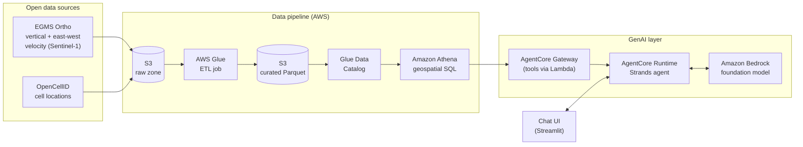

# 🛰️ InfraShield

**A GenAI agent that tells you which telecom sites are standing on moving ground.**

InfraShield combines satellite radar measurements of ground motion (InSAR) with mobile-network site locations. It flags sites threatened by landslides and subsidence, and explains the risk in plain language to network engineers and decision-makers.

> *"Which sites in the Ötztal moved more than 10 mm/year, and how sure are we?"*
> InfraShield answers with a ranked list, the evidence behind each site, and a short report you can forward to a field team.

**Status:** 🚧 early development (see [Roadmap](#roadmap))

---

## Why this matters

Mobile networks in mountain regions sit on unstable ground. Slow slope creep can tilt masts, strain fibre and power lines, and in the worst case destroy a site entirely. Operators usually learn about it from an outage or a field inspection.

Europe already measures this from space. The **Copernicus European Ground Motion Service (EGMS)** publishes millimetre-precision ground-motion data from Sentinel-1 radar for free. Still, that data rarely reaches the people planning and maintaining networks, because it lives in specialist GIS formats and needs expert interpretation.

InfraShield closes that gap:

1. **Joins** each network site with the satellite measurements around it
2. **Scores** the risk with transparent, explainable rules
3. **Explains** it through an AI agent that anyone can ask questions in plain language

## How it works



| Layer | What happens |
|---|---|
| **Ingest** | Download EGMS Ortho tiles (via the EGMS API) and OpenCellID data for the pilot region into S3 |
| **Transform** | Glue reprojects everything to a metric grid (EPSG:3035), groups cells into physical *sites*, and writes Parquet |
| **Score** | For every site, gather all ground-motion points within a radius and compute velocity statistics and a risk tier |
| **Query** | Athena exposes the curated tables; Lambda tools wrap safe, parameterised queries |
| **Explain** | A Strands agent on AgentCore Runtime calls those tools and answers questions with the evidence attached |

Design choices and trade-offs: [`docs/ARCHITECTURE.md`](docs/ARCHITECTURE.md)

## Risk scoring (transparent by design)

The LLM **never invents the risk level**. Risk is computed with deterministic rules, and the agent only explains the result.

For each site, InfraShield takes the EGMS points within 250 m, combines their vertical and east-west velocities into a total motion speed, and assigns a tier:

| Tier | Rule (90th-percentile motion speed) | Meaning |
|---|---|---|
| 🔴 **HIGH** | ≥ 10 mm/yr | Inspect soon |
| 🟠 **MEDIUM** | ≥ 5 mm/yr | Monitor closely |
| 🟢 **LOW** | < 5 mm/yr | No significant motion |
| ⚪ **UNKNOWN** | fewer than 3 points nearby | Not enough satellite evidence (common on forested or snowy slopes) |

The thresholds follow values used in published EGMS ground-deformation studies. They can be configured in `src/infrashield/risk.py`.

## Pilot region: Tyrol, Austria 🇦🇹

EGMS covers Copernicus participating countries. **Switzerland is currently a gap in the map**, because it isn't part of Copernicus. Tyrol was chosen instead because it has:

- dense Alpine terrain with many known landslides
- full EGMS coverage
- a conditions mix close to Switzerland's

The data-source layer is pluggable (`src/infrashield/sources/`), so a national InSAR product, such as a future Swiss dataset, can be added without touching the rest of the system.

## Quick start (local)

```bash
git clone https://github.com/<your-username>/infrashield.git
cd infrashield
python -m venv .venv && source .venv/bin/activate
pip install -e ".[dev]"
pytest                      # runs the risk-scoring tests on synthetic data
```

Real data requires:

- an **OpenCellID** API token (free): put it in `.env` (see `.env.example`)
- an **EGMS** account (free) for downloading ground-motion tiles

The agent can also run **fully locally** with [Ollama](https://ollama.com) instead of Bedrock, which is handy for development with no cloud costs.

## Roadmap

- [x] **M0 – Foundations:** repo, architecture, risk-scoring core with tests
- [ ] **M1 – Data:** EGMS and OpenCellID loaders, site clustering, pilot dataset for Tyrol
- [ ] **M2 – Analysis:** a site risk table, map visualisation and a validation notebook against known landslides
- [ ] **M3 – Agent (local):** a Strands agent with tools (`find_sites_at_risk`, `explain_site`, `site_report`) running on Ollama
- [ ] **M4 – AWS:** S3, Glue, Athena and Lambda tools on AgentCore Runtime and Gateway, deployed with AWS CDK
- [ ] **M5 – Polish:** Streamlit chat UI, demo video, cost estimate and blog post

## Limitations (being honest)

- **Cell locations are approximate.** OpenCellID positions are crowd-sourced estimates, not surveyed mast coordinates. InfraShield therefore clusters cells into approximate *sites* and uses a generous search radius. An operator would plug in its real site inventory.
- **InSAR measures only what the radar can see.** Forests, snow and steep slopes facing away from the satellite produce gaps, which is why the UNKNOWN tier exists.
- **EGMS is a 5-year average.** It shows sustained motion, not sudden events. It's a prioritisation tool, not an early-warning system.

## Data sources & attribution

- **Ground motion:** [European Ground Motion Service](https://land.copernicus.eu/en/products/european-ground-motion-service), Copernicus Land Monitoring Service. Free and open under the Copernicus data policy.
- **Cell locations:** [OpenCellID](https://opencellid.org) by Unwired Labs, licensed under [CC BY-SA 4.0](https://creativecommons.org/licenses/by-sa/4.0/).

Raw data is **not** committed to this repository. See [`data/README.md`](data/README.md).

## About

Built by **Saniya Behzadpour**: Senior AI Engineer (GenAI on AWS) with a PhD in satellite geodesy.
This is a personal project. It isn't affiliated with any employer or network operator, and it uses only public, open data.

## License

Code: [MIT](LICENSE). Data keeps the licence of its source (see above).
